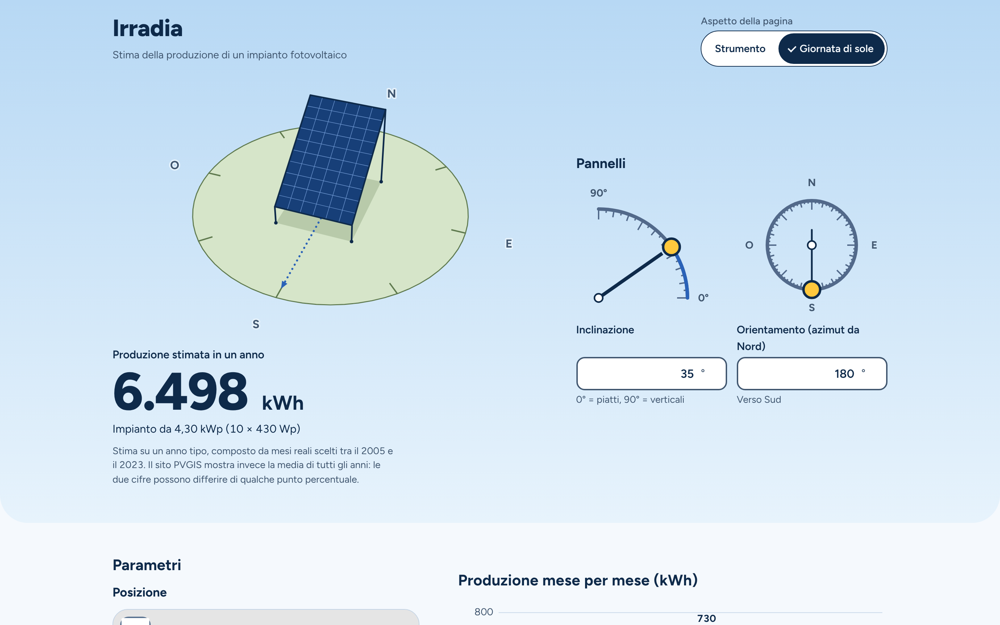

# Irradia

A browser app that estimates how much energy a rooftop solar (PV) system will
produce, using **deterministic, documented physics** and measured historical
weather data. No AI and no opaque statistical model is used in the calculation.



> The app's interface is in Italian: the first target users are in Italy and Europe.

## What it does

Pick a location on the map (or type the coordinates). Set the panels' tilt and
orientation with angle-shaped dials. Choose the number of panels, their power and
the system losses. The app shows the estimated **annual energy (kWh)** and a
**month-by-month chart**, and updates instantly as you move a control.

Weather data come from **PVGIS** (European Commission, Joint Research Centre). The
app uses a typical meteorological year of 8,760 hourly values, downloaded once per
location.

## The core principle: deterministic and verifiable

Every number the app shows comes from published physical models, applied hour by
hour, and the code cites the source of each formula. The same inputs always give
the same result, and every step can be checked against an independent reference.

For each of the 8,760 hours:

1. Sun position: NOAA / Meeus algorithm.
2. Light on the tilted panel:
   - direct light, from geometry;
   - diffuse light from the sky, with the Muneer model as in PVGIS 5.3;
   - light reflected by the ground, with albedo 0.2.

   Shading by the terrain (mountains, hills) is already applied by PVGIS to the
   input data.
3. Reflection losses on the module glass: Martin & Ruiz.
4. Module temperature (Faiman) and DC power (Huld et al., 2011).
5. System losses (inverter, cables and so on; 14 % by default).

The hours are then summed into monthly and annual kWh. The model deliberately
mirrors PVGIS 5.3, so that comparing against PVGIS measures *our* errors, not
differences between models.

## Validation against PVGIS

The engine is tested against values published by PVGIS. The PVGIS responses are
saved in the repository, so the tests run offline and always give the same result.

| Check | Locations | Tolerance |
|---|---|---|
| Hour by hour vs the PVGIS hourly series for 2020 (annual sums) | Rome, Milan | direct ±0.3 %, diffuse ±0.2 %, reflected ±0.3 %, energy ±1 % (Milan, South 35°: +0.42 %) |
| Each month of the typical year vs the same real month (PVGIS MRcalc) | Rome, Milan | light on the panel ±1 %, horizontal ±0.5 %, year ±0.5 % |
| Conversion of light into energy vs PVGIS PVcalc | Rome, Milan | ±1.5 % (Milan −0.5 %: spectral effect, not modelled) |
| Terrain shading | Aosta (Alps) | shaded hours match the PVGIS horizon profile within 0.25°; ratio of light on the panel with / without terrain shading vs the same real month in PVGIS MRcalc: months ±0.5 % (worst measured +0.26 %), year ±0.1 % |

**Why the app's total can differ from the PVGIS website by a few percent.** The app
uses a *typical year* made of 12 real months chosen from 2005 to 2023, while the
website shows the average of all years. In Milan, for example, the typical year is
about 4 % sunnier than the average. This is not an error of the engine, and the app
says so under the total.

**Testing:** 525 unit and property-based tests (Vitest, and fast-check with a fixed
seed) and about 460 browser tests (Playwright) on the production build, all run in
continuous integration (CI) on every change.

## How this project is built

This project is also an experiment in **managing software development as a
Product Owner with a team of AI agents**.

- **The code, tests and documentation were written by AI agents** (Claude Code,
  by Anthropic). I did not write the code myself.
- **My role is the Product Owner's.** I set the goals and choose between the options
  that the agents present with their trade-offs. I also approve the plans, check
  the results and decide what gets merged.
- **The team** is a set of agents with written job descriptions (in Italian) in
  [`.claude/agents/`](.claude/agents): Technical Leader, Software Developer,
  Designer, Software Tester, CI/CD and Project Manager.
- **The workflow:** each piece of work goes through these steps:
  1. an issue;
  2. a technical plan with acceptance criteria;
  3. implementation on a separate branch;
  4. independent testing;
  5. a draft pull request;
  6. continuous integration;
  7. my review and merge.

  The project status is kept in a dedicated issue (#22).
- **Every decision and its reason** is recorded in [`CLAUDE.md`](CLAUDE.md) (in
  Italian).
- **Quality does not rely on trusting the AI.** Results are checked against an
  independent reference (PVGIS) with explicit tolerances, and CI runs every check
  on every change.

Issues and pull requests #1 to #64 are copies from an earlier private repository.
It was recreated to remove personal data from the history, so the original diffs
and CI runs of those pull requests are not available here.

## Repository tour

```
src/engine/   calculation engine: pure TypeScript, no React; each module has its tests
src/ui/       React components and their pure logic
e2e/          browser tests (Playwright) with simulated PVGIS data and map tiles
scripts/      CI tools (size check of the initial JavaScript)
.claude/      job descriptions and skills of the AI agents
CLAUDE.md     decision log and project rules (Italian)
```

## Run it locally

Requires Node.js 24 (the version used in CI).

```bash
npm install
npm run dev       # http://localhost:5173
npm test          # unit and property tests (offline)
npm run test:e2e  # browser tests
```

PVGIS does not send CORS headers, so a browser cannot call it directly. In
development, the Vite dev server forwards the requests. The public version will
need a small server-side proxy.

## Status

Done:
- sun position;
- PVGIS data, including terrain shading;
- production model, validated against PVGIS;
- interface with chart, map and two visual styles.

Next: online deployment. Economic estimates (costs, savings) are intentionally out
of scope for now.

## Data sources and credits

- **Weather and solar data:** Photovoltaic Geographical Information System (PVGIS)
  of the European Commission Joint Research Centre,
  <https://joint-research-centre.ec.europa.eu/photovoltaic-geographical-information-system-pvgis_en>.
  PVGIS 5.3 uses the PVGIS-SARAH3 and ERA5 databases. Irradia is an independent
  project, not affiliated with or endorsed by the European Commission.
- **Map:** © OpenStreetMap contributors.
- **Fonts:** Barlow, Barlow Semi Condensed and Figtree (SIL Open Font License 1.1).
- **Details and licences of third-party material:**
  [`THIRD_PARTY_NOTICES.md`](THIRD_PARTY_NOTICES.md).
- **Scientific references:**
  - J. Meeus, *Astronomical Algorithms*, 2nd ed., 1998;
  - NOAA, *Solar Calculator*;
  - I. Reda, A. Andreas, NREL/TP-560-34302, 2008;
  - J. A. Duffie, W. A. Beckman, *Solar Engineering of Thermal Processes*, 4th ed., 2013;
  - T. Muneer, 1990;
  - J. Hofierka, M. Šúri, 2002;
  - N. Martin, J. M. Ruiz, 2001;
  - D. Faiman, 2008;
  - T. Huld et al., 2011.

  Full citations are in the source code, next to each formula.

## Licence

Copyright © 2026 Mattia Longo. **All rights reserved.** The code is public so that
it can be read. No licence to reuse it is granted: see [`LICENSE`](LICENSE).
Third-party material keeps its own licence: see
[`THIRD_PARTY_NOTICES.md`](THIRD_PARTY_NOTICES.md).

To report a security problem, see [`.github/SECURITY.md`](.github/SECURITY.md).
